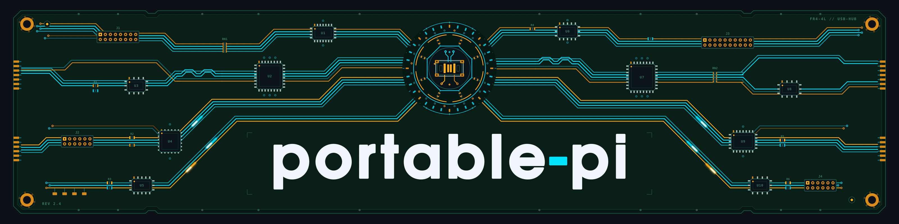

<p align="center">
  
</p>

# portable-pi

**A self-contained USB drive that runs the `pi` coding agent on Windows and Linux.**
Plug it in, launch, work, unplug. Nothing is installed on the host.

[](LICENSE)


Sessions, credentials, skills and caches stay on the drive. The host machine is not
touched, and the agent needs no service running on your network: internet is enough.

```
Windows  → double-click start.bat
Linux    → bash /media/$USER/PORTABLE-PI/start.sh
```

Content: ~430 MB base, ~7,600 files; a drive profile with a few extensions and skills typically
adds 40–150 MB (dependency closures included). Recommended drive: **2 GB exFAT, USB 3.0**.

---

## Why

You are at a friend's place. Their code is broken, or you want your own agent with your
own settings on a machine that is not yours. Installing Node.js, an agent, your skills and
your credentials is too much friction — and leaves traces behind.

portable-pi is a flash drive with everything already in place: a portable Node.js runtime,
the `pi` agent with its prebundled ESM build, your skill whitelist, your credentials, and
MinGit so the agent's shell tool works even on a Windows box without Git.

## What is on the drive

| Component | Role | Size | Files |
|---|---|---|---|
| Node.js 24 LTS (win-x64 + linux-x64) | portable runtime, no install | 102 + 192 MB | 6,794 |
| `pi` 1.6.0 (`dist/bundle` + `pi-tui` + `photon-node` + `jiti`) | the agent (`jiti` is an unbundled runtime dependency: it transpiles TypeScript extensions) | 19 MB | 390 |
| Skill whitelist | plain instructions, no external device needed | depends on your selection | — |
| Vendored packages (optional) | drive profile only: extensions from npm, copied with their dependency closure | depends on your selection | — |
| Host SDK (optional) | drive profile only, when a package sets `requiresHostSdk`: lets child pi processes start (pi-subagents) | ~65 MB | ~7,800 |
| MinGit (Windows only) | guarantees `bash` and `git` on a bare host | 94 MB | 376 |
| `config/pi/` | agent dir: auth, settings, models, AGENTS.md, skills, sessions | — | — |

The base is **pi only**: the public repo ships no skill names and no extensions
(`config/pi/settings.json` has no `packages`, CI enforces it). Everything else is your
drive profile: you provide a `skills.local.json` (gitignored, see `skills.example.json`)
with `include` (skills), `packages` (extensions) and `settings`, and the build merges it
into the drive's manifest.

Included packages are **vendored, not installed at run time**: `scripts/vendor-packages.mjs`
copies each package and its dependency closure from the build machine's pi npm dir into
`config/pi/packages/node_modules`, and `settings.json` points at them with drive-relative
paths (`./packages/node_modules/<name>`), so a different drive letter needs no repair. The
skills a package exposes are mirrored into `config/pi/skills` because `-ns` disables package
skill discovery.

Not shippable even in a profile: MCP servers bound to a LAN service, self-hosted providers,
anything that requires another machine, and anything that needs a GPU box. See
[docs/scope.md](docs/scope.md) for the selection policy.

## Isolation model (verified, not promised)

The launcher sets:

```
PI_CODING_AGENT_DIR=<usb>/config/pi
PI_CODING_AGENT_SESSION_DIR=<usb>/config/pi/sessions
PI_SKIP_VERSION_CHECK=1   PI_TELEMETRY=0
WIKI_HOME=<usb>/workspace          (llm-wiki personal vault stays on the drive)
TMP / TEMP / TMPDIR / NPM_CONFIG_CACHE / NODE_COMPILE_CACHE / XDG_CACHE_HOME → <usb>/temp
```

and starts the agent as:

```
pi -ns --skill <usb>/config/pi/skills
```

`-ns` disables every discovered skill — including the host's `~/.agents/skills` — while the
paths given to `--skill` keep loading. As a result:

- sessions are created and kept on the drive; the host `~/.pi/agent` is never read or written;
- the skills loaded are exactly the ones on the drive, package-provided skills included
  (the build mirrors them into `config/pi/skills`);
- extensions, packages, MCP servers, prompt templates and themes come only from `config/pi`;
- `HOME`/`USERPROFILE` stay the host's, so git and npm still see the user config of the
  machine you are on.

Isolation here is **configuration-level, not a sandbox**: the agent runs with the
operating-system permissions of the user who started it and can reach files outside the
drive. For a real boundary use a container, a VM, or a dedicated guest account.

Automated check:

```powershell
powershell -ExecutionPolicy Bypass -File scripts\verify.ps1 -Drive E:\
```
```bash
bash scripts/verify.sh /media/$USER/PORTABLE-PI
```

It checks layout, the skill whitelist, the vendored packages and their settings entries,
absence of host references (no SearXNG, no LAN address), the launcher, a live turn
with a marker, the skill set actually visible to the model (must be the drive's, no leakage),
the session landing on the drive, and a hash snapshot of the host config before/after. It
exits non-zero if anything is written outside the drive. `--no-model` for static checks only.

## Requirements

| Requirement | Detail |
|---|---|
| Drive | 2 GB exFAT, **USB 3.0 recommended** |
| Host | Windows 10/11 x64 or Linux x64 (glibc ≥ 2.28) |
| Network | internet for the model (no local server needed) |
| Build host | Windows 10 1803+ (needs `tar.exe`) **or** Linux with `curl`, `tar`, `unzip`, `node` |

## Build

```powershell
powershell -ExecutionPolicy Bypass -File scripts\build.ps1 -Target E:\
```
```bash
bash scripts/build.sh /media/$USER/PORTABLE-PI
```

Options: `-SkipGit`/`--skip-git` (no MinGit, −94 MB), `-PiVersion x.y.z`, `-NodeVersion x.y.z`,
`-SmokeTest`/`--smoke`, `-Force`/`--force`.

The build is idempotent: re-running it updates pi and the skills without touching
`auth.json` and `sessions/` (unless you pass `-Force`).

**Skill whitelist.** Copy `skills.example.json` to `skills.local.json` and list the skill
directories you want (`root` is one of `agent`, `agents`, `npm`; `path` is relative to that
root). The file is gitignored, so your selection never lands in this repository; the build
merges it into `<drive>/manifest.json`, which is the record of what the drive contains.

## Update an existing drive

```powershell
powershell -ExecutionPolicy Bypass -File E:\scripts\update.ps1
powershell -File E:\scripts\update.ps1 -PiVersion latest
powershell -File E:\scripts\update.ps1 -ForcePi -Node latest
```
```bash
bash /media/$USER/PORTABLE-PI/scripts/update.sh --pi latest --node latest
```

It reads the drive's own `manifest.json` (no repo needed), swaps the pi runtime packages,
optionally updates Node (sha256 verified), refreshes the whitelisted skills **only if this
PC has the source folders**, updates the versions recorded in the drive manifest, then runs
the static verifier. It never touches `auth.json`, `sessions/`, `settings.json`,
`models.json`, `AGENTS.md` or skills you added by hand.

## Skills and extensions (staying isolated)

The agent dir `config/pi` **is** the agent's environment. The base repo is deliberately
empty (no `packages`, no skills); your `skills.local.json` profile decides what travels.

**Preferred: declare it in the profile, then rebuild.** The build vendors the packages from
this machine's `~/.pi/agent/npm/node_modules`, so the drive starts offline with no install
step and no registry access:

```json
{
  "include": [ { "name": "example-skill", "root": "agent", "path": "skills/example-skill" } ],
  "packages": [
    { "name": "pi-web-access", "spec": "npm:pi-web-access@0.48.0",
      "skipOptional": [], "reason": "bundled extension, zero-config search via Exa MCP" }
  ],
  "settings": { "subagents": { "defaultModel": "provider/model-id" } }
}
```

Profile fields:

| Field | Meaning |
|---|---|
| `include[]` | `{ name, root, path }` — a skill copied to `config/pi/skills/<name>`; `root` is `agent` (`~/.pi/agent`), `agents` (`~/.agents`) or `npm` (`~/.pi/agent/npm/node_modules`) |
| `packages[]` | `{ name, spec, reason, skipOptional?, configFiles?, requiresHostSdk? }` — an extension vendored under `config/pi/packages/node_modules/<name>` |
| `packages[].skipOptional` | optional dependencies that must **not** be vendored (native builds, 2 GB models: e.g. `@tobilu/qmd`) |
| `packages[].requiresHostSdk` | the package imports the host pi SDK or spawns child pi processes; the build also vendors that closure into `tools/pi` |
| `settings{}` | extra keys merged into the drive's `config/pi/settings.json` (e.g. `subagents`); LAN endpoints are never allowed |
| `exclude[]` | `{ name, reason }` — documentation of what you left out and why |

`scripts/vendor-packages.mjs` derives the dependency closure (`dependencies` +
`optionalDependencies` minus `skipOptional`), never copies host-provided peers
(`@earendil-works/*`, `typebox`) unless `--allow-host-provided` is used for the host SDK
step, dereferences symlinks (exFAT), strips source maps, `.d.ts` and `src/*.ts` (keeping the
`docs/*.md` that pi's system prompt references), and skips tests and multi-megabyte gallery media. `update.ps1`/`update.sh` refresh the vendored packages when
this machine has the sources.

**Manual install on a running drive** still works, for a quick test:

| Action | Correct command | Where it lands |
|---|---|---|
| Install an extension/package | `pi install npm:<pkg>` | `config/pi/npm` + `config/pi/settings.json` |
| Try without installing | `pi -e npm:<pkg>` | cache in `config/pi/tmp/extensions` |
| Add a skill by hand | `config/pi/skills/<name>/SKILL.md` | loaded directly |
| Uninstall | `pi remove npm:<pkg>` | — |

A manual install is **not** reproduced by a rebuild: the build mirrors the profile and prunes
packages that are not in `packages[]`. Add it to the profile instead.

Avoid, because they write outside the drive: `-l`/`--local` on `pi install` (writes
`.pi/settings.json` **in the host project**), `npm install -g`, `pip install --user`,
`apt`/`brew`/`winget`, and writing into the host's `~/.agents/skills` or `~/.pi/agent`.

Windows and Linux **share the same agent dir**: prefer pure JS/TS extensions. A package with
native binaries (`*.node`, dependencies with `os`/`cpu`) only works on the system where you
installed it. That is also why a package whose optional dependency is a native build or a
2 GB model (e.g. `@tobilu/qmd` for llm-wiki embeddings) belongs in `skipOptional`.

### LLM Wiki without embeddings

`@zosmaai/pi-llm-wiki` works with lexical recall only: embeddings are optional and no-op when
no embedding provider is configured, so no server on the LAN is needed. The vault follows
`WIKI_HOME`, which the launcher sets to `<usb>/workspace`, so the personal vault is
`<usb>/workspace/.llm-wiki` and never `~/.llm-wiki` on the host.

### Extensions that spawn child pi processes

`pi-subagents` (and anything using the subagent tool) cannot run on the bundled `dist` alone:
the child imports the **host packages** — `@earendil-works/pi-coding-agent/dist/index.js`,
`pi-agent-core`, `pi-ai` and `typebox` with their dependency closure. Mark such a package
`"requiresHostSdk": true` in the profile and the build also vendors that closure into
`tools/pi/node_modules` from this machine's pi installation
(`~/.pi/agent/install/releases/<version>/node_modules`). Cost: about 65 MB / 7,800 files, and
the drive copy is stripped of source maps, `.d.ts`, changelogs and `src/*.ts` (`docs/*.md` is
kept because the system prompt references it).

### Git on the drive

exFAT records no ownership, so git refuses a repository it does not own. The launchers set
`GIT_CONFIG_COUNT=1 GIT_CONFIG_KEY_0=safe.directory GIT_CONFIG_VALUE_0=*` in the environment
instead of writing `safe.directory` into the host's `~/.gitconfig`.

### Web access without SearXNG

`pi-web-access` needs no key: `auto` falls back to public Exa MCP, and `config/pi/web-search.json`
ships as `{"provider": "auto"}`. SearXNG is deliberately absent because it is a self-hosted
Python service — not portable. Add API keys to that file on the drive if you want a paid
provider; never point it at a LAN address.

## Limits

- **exFAT and POSIX permissions.** Some distros mount the drive with `fmask=0113`, so `node`
  is not executable. The launcher detects it and prints the fix:
  `sudo umount … && sudo mount -o remount,umask=000 …`, or an `/etc/fstab` line with
  `LABEL=PORTABLE-PI … exfat defaults,uid=$(id -u),umask=000 0 0`.
- **Legacy Windows console.** The TUI needs VT support (Windows 10 1511+). On very old hosts
  use Windows Terminal.
- **Imagemagick-free image support** relies on a WASM module; one skill in the whitelist may
  download its own engine on first use if you include it on a platform where no binary ships.
- **x64 only.** ARM64 is not covered by the manifest.
- **USB 2.0**: startup takes seconds; most of the file count is Node.
- `rg`/`fd` are not shipped: pi downloads them into `config/pi/bin` on first use (needs
  network) or falls back to its built-in walk.

## Secrets

`config/pi/auth.json` holds OAuth tokens / API keys **in plaintext** on the drive. If you
lose the drive:

1. revoke the credentials of the providers listed in that file, or
2. start pi elsewhere and use `/logout` for the affected providers.

`config/env.sh` and `config/env.bat` (keys via environment, e.g. `OPENMODEL_API_KEY`) are
created by the build from the templates and are never committed.

## Where sources, installer and temp files live

| Thing | Location | Lifetime |
|---|---|---|
| **Sources + installer** (this repo: `scripts/`, `config/`, `docs/`, `manifest.json`) | wherever you cloned it | permanent, ~200 KB, under git |
| **Built runtime** (Node, pi, MinGit, skills, auth) | the USB drive | lives on the drive |
| **Maintenance scripts** (`verify`, `update`) | `<drive>/scripts/` **and** this repo | copied to the drive on every build |
| **Build staging** (downloads, extractions) | `%TEMP%\portable-pi-build-*` / `mktemp -d` | **deleted** at the end of every build/update |
| Download sources | `nodejs.org`, `registry.npmjs.org`, `github.com/git-for-windows` | network, no persistent cache |

Nothing essential lives in a temp directory. The repo carries no binaries and no secrets: it
rebuilds from scratch with `scripts/build.ps1` or `scripts/build.sh` starting from
`manifest.json`.

## Repository layout

```
portable-pi/
├── manifest.json              what to build: versions, packages, git payload
├── skills.example.json        shape of the drive profile (copy to skills.local.json)
├── assets/banner.png          repository banner
├── README.md · llms.txt · NOTICE
├── start.bat / start.sh       launchers copied to the drive
├── autorun.inf                volume label/icon (Windows ignores AutoRun on USB)
├── config/
│   ├── pi/                    agent-dir templates: settings, models, AGENTS.md, web-search
│   └── env.example.{sh,bat}   optional API keys
├── scripts/
│   ├── build.ps1 / build.sh   build a drive from the manifest
│   ├── vendor-packages.mjs    copy profile packages + dependency closure onto the drive
│   ├── update.ps1 / update.sh update an existing drive
│   ├── verify.ps1 / verify.sh assert the isolation guarantees
│   └── shims/                 pi / pi.cmd put on PATH by the launcher
├── docs/
│   ├── scope.md               selection policy: what ships and what cannot
│   ├── workspace.md           what <drive>/workspace is (cwd + llm-wiki vault)
│   └── manifest.schema.json   manifest schema
└── .github/workflows/         validation CI
```

## Provenance and attribution

This project is a **rewrite for `pi`** of the ideas and USB layout of
[`bnovik0v/portable-agent-usb`](https://github.com/bnovik0v/portable-agent-usb) (MIT, 2026),
which ships Claude Code and Codex on a stick.

**It is not a git fork**: no commit is shared and no source file is copied verbatim. What
came from the original and what is new is listed in [`NOTICE`](NOTICE), together with the
upstream MIT text.

Other attributions:

| Component | License |
|---|---|
| `pi` / `@earendil-works/*` | MIT |
| `@silvia-odwyer/photon-node` | Apache-2.0 |
| Node.js | MIT (OpenJS Foundation) |
| MinGit / Git for Windows | GPL-2.0 — downloaded at build time, not in this repo; its `LICENSE.txt` stays on the drive |
| third-party skills | see each skill's `SKILL.md` |

## For crawlers and LLM agents

- [`llms.txt`](llms.txt) — machine-readable summary: what it is, isolation model, keywords,
  where build and verification live.
- [`manifest.json`](manifest.json) — source of truth for what gets built.
- [`docs/scope.md`](docs/scope.md) — the selection policy for skills.

## License

MIT — see [LICENSE](LICENSE).
